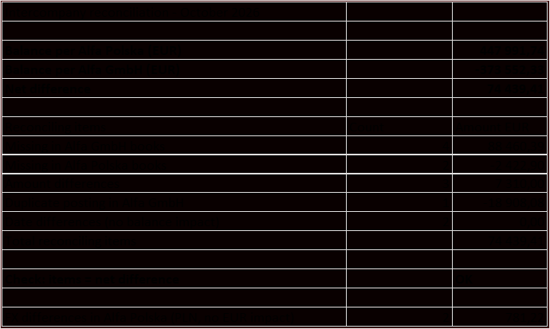
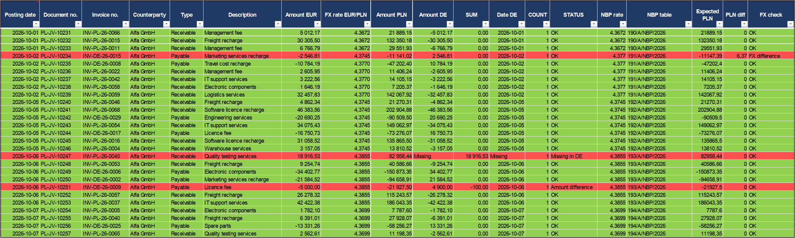
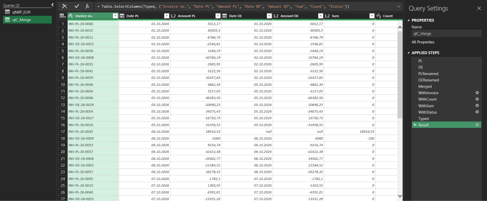

# Intercompany Reconciliation in Excel - October 2026

Month-end reconciliation of intercompany balances between two group companies, built in Excel with formulas, Power Query and VBA.

The balances in the two ledgers should offset each other, but they differ by **EUR 74,439.41**. The workbook finds every difference, classifies it, explains it and proves that the explanations add up to the full balance difference.



## Data

The two ledgers are **synthetic**: the companies (Alfa Polska sp. z o.o. and Alfa GmbH), invoices and amounts are fictional. They were prepared for this exercise to reproduce typical month-end intercompany issues, such as cut-off timing, missing or duplicate postings and amount errors.

The **exchange rates are real**: NBP average EUR/PLN rates (Table A) from 30 September to 30 October 2026 (tables 190/A-212/A), imported with Power Query from the NBP API.

| Sheet | Content |
|---|---|
| `Ledger_PL` | Alfa Polska sp. z o.o. (functional currency PLN), 113 postings in EUR with the posted FX rate and PLN amount |
| `Ledger_DE` | Alfa GmbH (EUR), 112 postings |
| `FX_EUR_PLN` | NBP average EUR/PLN rates for business days, with table numbers |

Rules in the data:
- the same invoice has the same number in both ledgers,
- amounts have opposite signs (receivable +, payable -),
- Alfa Polska translates EUR to PLN at the NBP rate from the last business day **before** the invoice date.

## Result

| Reconciling item | Invoices | EUR impact |
|---|---|---|
| Cut-off: Alfa Polska invoices booked by Alfa GmbH in November | 3 | 69,543.86 |
| Cut-off: Alfa GmbH invoice not yet booked by Alfa Polska | 1 | 16,493.63 |
| Sign error in Alfa GmbH (payable posted as receivable) | 1 | 7,500.00 |
| Unagreed 2% discount | 1 | -100.00 |
| Transposed digits (12,450.00 vs 12,540.00) | 1 | -90.00 |
| Duplicate posting in Alfa GmbH | 1 | -18,908.08 |
| Invoice number typo (INV-PL-26-0045 vs INV-PL-26-045) | 1 | 0.00 |
| Different posting dates within October | 2 | 0.00 |
| **Total = balance difference** | **11** | **74,439.41** |

Separately, two FX translation errors in Alfa Polska (same-day rate used instead of the previous business day) misstate PLN amounts by PLN 6.37 and PLN 774.85. They have no impact on the EUR balance.

## How it works

1. **Tables and structured references.** Both ledgers and the FX rates are Excel tables (`tPL`, `tDE`, `tFX`), so every formula, pivot and query grows with the data.
2. **Two-way matching.** `XLOOKUP` brings the counterparty's amount and posting date for every invoice, from PL to DE and from DE to PL, so items missing on either side are visible.
3. **Status logic.** `COUNTIFS` flags duplicates, and an `IFS` status column classifies each posting as OK, missing, amount difference, date difference or duplicate.
4. **FX check.** `XLOOKUP` with match mode -1 on `date - 1` finds the rate from the previous business day; the expected PLN amount is compared with the posted one.
5. **Conditional formatting** highlights every row with a difference.
6. **PivotTables** count and sum the differences by status for each ledger.
7. **Reconciliation sheet.** Balance per each company, net difference, reconciling items calculated with `SUMIFS` (each item counted once and from the correct side), and a control check that the items equal the balance difference. `FILTER` lists the items, and the explanation for each invoice is pulled from the `Explanations` table.
8. **Explanations.** One sentence per item: what happened and who should correct it.



## Automation

**Power Query**
- `qNBP_EUR` imports the EUR rates from the NBP API (`api.nbp.pl`); a check on the `Checks` sheet confirms that all 23 rates match the `FX_EUR_PLN` sheet.
- `qIC_Merge` merges both ledgers with a full outer join and repeats the status logic. The status counts match the formula results, which gives an independent cross-check.
- The M code is in [`powerquery/`](powerquery/).



**VBA**
- `RefreshAndExportReconciliation` refreshes all queries and pivot tables, checks that the reconciliation closes, and exports the `Reconciliation` sheet to PDF.
- The code is in [`vba/`](vba/).

## How to use

1. Open `IC_Reconciliation_Oct2026.xlsm` and click **Enable Content**.
2. Run the macro with the **Refresh & export PDF** button on the `Reconciliation` sheet (or `Alt+F8` > `RefreshAndExportReconciliation` > Run).
3. The PDF is saved next to the workbook as `IC_Reconciliation_YYYY-MM-DD.pdf`.

Requires Excel for Microsoft 365 (`XLOOKUP`, `FILTER`, `HSTACK`, `LET`).

## Repository structure

```
IC_Reconciliation_Oct2026.xlsm   workbook
output/                          exported PDF
powerquery/                      M code of the two queries
vba/                             VBA module
screenshots/                     images used in this README
```
